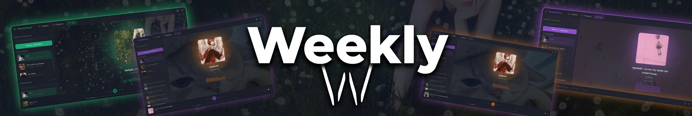

  # 🎵 Weekly Player

  

    <strong>Легковесный и современный десктопный аудиоплеер, созданный для комфорта, простоты и чистого удовольствия от прослушивания музыки.</strong>
  

  

    
    
    
  

   

  

---

### 📸 Скриншоты

  <table>
    <tr>
      <th align="center">Главная</th>
      <th align="center">Плейлисты</th>
      <th align="center">Настройки</th>
    </tr>
    <tr>
      <td align="center">
        
      </td>
      <td align="center">
        
      </td>
      <td align="center">
        
      </td>
    </tr>
  </table>

---

### ✨ Возможности

- 🎧 **Интеграция с SoundCloud:** Быстрый импорт и прослушивание любимых треков и плейлистов напрямую из SoundCloud.
- 📁 **Поддержка локальных файлов:** Простое добавление и удобная организация вашей офлайн-медиатеки.
- ⚡ **Быстрый и нетребовательный:** Разработан на базе **Tauri**, что гарантирует минимальное потребление оперативной памяти и мгновенный запуск в отличие от аналогов на Electron.
- 🎨 **Современный минималистичный интерфейс:** Чистый, адаптивный UI без визуального шума на базе React и TypeScript.

---

### 🛠 Стек технологий

Weekly создан с использованием современных веб- и нативных десктопных технологий:

| Компонент | Технология |
| :--- | :--- |
| **Десктопный фреймворк** | [Tauri](https://tauri.app/) (нативная производительность на Rust) |
| **Фронтенд-библиотека** | [React](https://react.dev/) |
| **Язык разработки** | [TypeScript](https://www.typescriptlang.org/) |
| **Источники аудио** | SoundCloud API и локальная файловая система |

---

### 📥 Скачивание и установка

Готовы к прослушиванию? Скачайте последнюю готовую сборку для вашей операционной системы:

   
  
    

*Или посетите страницу [Релизов](https://github.com/Pickramag/Weekly-Player/releases), чтобы увидеть список изменений и предыдущие версии.*

### 💬 Сообщество и обратная связь

Weekly изначально разрабатывался как пет-проект для личного использования и друзей. Если вы нашли баг, хотите предложить улучшение или просто пообщаться:

- 📢 Подписывайтесь на Telegram-канал: [@weekgamesdev](https://t.me/weekgamesdev)
- 🐛 Создайте [Issue](https://github.com/Pickramag/Weekly-Player/issues) на GitHub

---

  Сделано с ❤️ от <a href="https://github.com/Pickramag">Pickramag</a>

